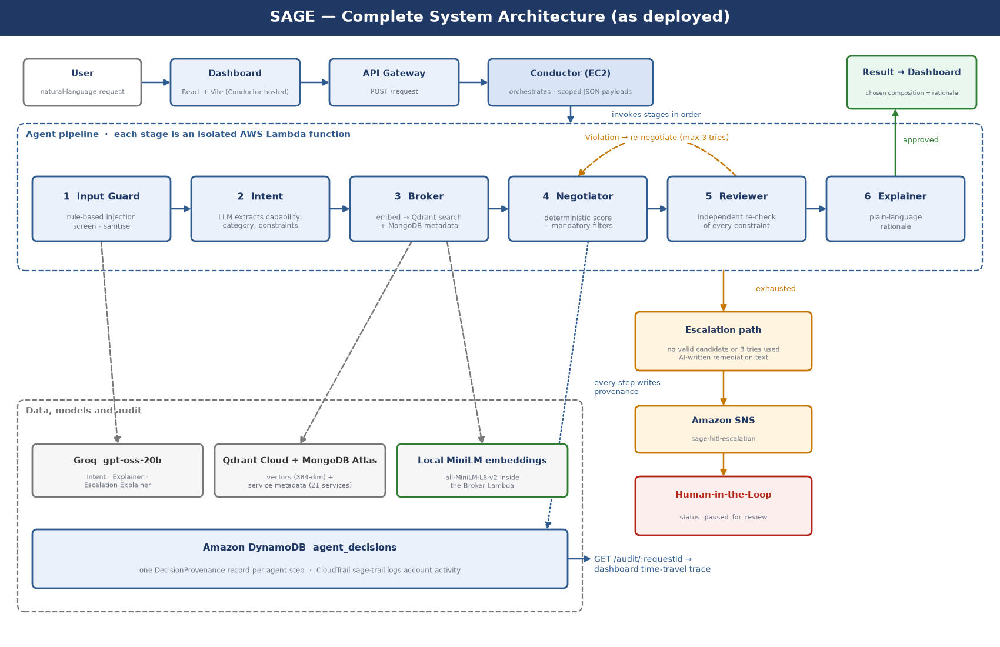
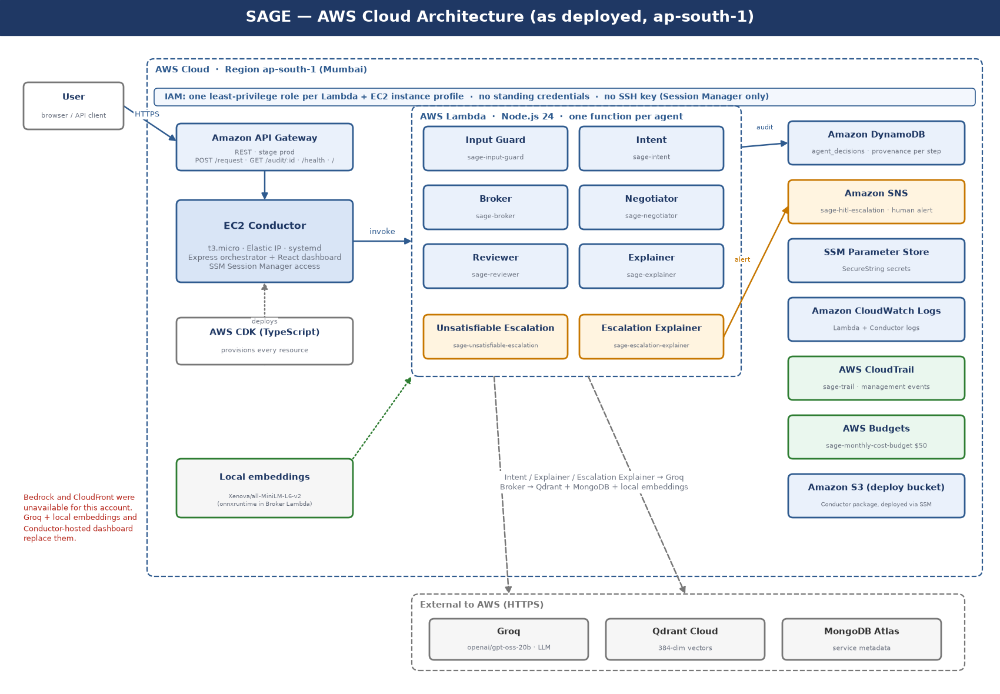

# Architecture

SAGE turns a plain-English request into a verified, explained and audited service choice. This document describes how the system is built and why.



## Request flow

```
request → Input Guard → Intent → Broker → Negotiator ⇄ Reviewer → Explainer → response
                                              (at most 3 tries)        │
                                  no valid service / tries used up ────┴──▶ human escalation (SNS)
```

A **Conductor** service receives the request and calls each agent in order, passing only a small, typed payload (`packages/shared-types`) between them, never the full conversation history. Every agent writes a decision record to DynamoDB, linked to the record before it, so the whole decision path can be replayed afterwards (the dashboard does exactly that).

## Agents

| Agent | Kind | Technique | LLM? |
|---|---|---|---|
| **Input Guard** | Simple reflex agent | Pattern rules detect prompt injection; matched phrases are replaced with `[filtered]` and the request continues | No |
| **Intent** | Classifier / extractor | A language model turns the request into a capability, one of 17 categories and structured constraints (price, uptime, latency; mandatory or preferred) | Yes |
| **Broker** | Retrieval | Embeds the request (`all-MiniLM-L6-v2`, 384 dimensions, computed locally), searches the vector store (similarity ≥ 0.35), then joins exact service attributes from the metadata store | No |
| **Negotiator** | Utility-based agent | Hard filters, then a deterministic weighted score (below) | No |
| **Reviewer** | Independent verifier | Re-derives every mandatory constraint with its own logic; on a violation it returns a structured `Violation` to the Negotiator (max 3 tries), then escalates | No |
| **Explainer** | Text generation | Writes a plain-language rationale, or remediation advice for an escalated request | Yes |

### How the Negotiator chooses

1. **Hard filters.** Drop candidates in the wrong category, those previously rejected by the Reviewer, and any that break a mandatory constraint (a missing field counts as a failure).
2. **Normalise.** Min–max scale price, uptime, latency and similarity across the surviving candidates to `[0, 1]` (price and latency inverted so lower is better). If every candidate ties on a dimension it scores `1`.
3. **Weighted average.**

   ```
   score = (w_price·price' + w_uptime·uptime' + w_latency·latency' + 0.5·similarity')
           / (w_price + w_uptime + w_latency + 0.5)
   ```

   Weights default to `1`; a user's stated priority overrides the matching weight.
4. **Select** the highest score, breaking ties by `serviceId`, so the same input always yields the same output. The full per-dimension breakdown is stored with the decision.

Scores are relative: if only one candidate survives the filters it scores `1.000` by construction.

## Knowledge representation

- Each service is a **frame** with named slots: `serviceId`, `name`, `description`, `capability`, `price`, `uptime`, `latencyMs`, `dependencies`, `constraints`, `endpoint` (see [`data/services.json`](../data/services.json), versioned in [`data/CHANGELOG.md`](../data/CHANGELOG.md)).
- The 17 capability categories form a flat **taxonomy**; Intent classifies each request into one and the category is then enforced as a hard rule.
- Constraints are **rules** over slot values, evaluated as a conjunction by both Negotiator and Reviewer.

## Reliability and accountability

- **Bounded retries.** The Negotiator ⇄ Reviewer loop is capped at three iterations; after that, or when no candidate exists, the request is escalated to a human and marked `paused_for_review`. Every failure path ends with a human, never a silent guess.
- **Decision provenance.** One `DecisionProvenance` record per agent step (input, output, reasoning, parent decision) in DynamoDB, exposed at `GET /audit/:requestId`. AWS CloudTrail provides the account-level audit layer.
- **Independent verification.** The Reviewer never trusts the Negotiator's self-reported result.

## Deployment



| Component | Service |
|---|---|
| Agents | 8 AWS Lambda functions (Node.js 24), one least-privilege IAM role each |
| Orchestration | Conductor (Express) on an EC2 `t3.micro` behind API Gateway; also serves the dashboard |
| Decision records | Amazon DynamoDB (`agent_decisions`) |
| Human escalation | Amazon SNS (`sage-hitl-escalation`) |
| Audit and cost | AWS CloudTrail, AWS Budgets ($50/month alerts) |
| Secrets | SSM Parameter Store (SecureString) |
| Infrastructure as code | AWS CDK (TypeScript) in [`infra/cdk`](../infra/cdk); no NAT gateways |
| External services | Qdrant Cloud (vectors), MongoDB Atlas (metadata), Groq (`openai/gpt-oss-20b`) |

The Conductor is a steady, always-on coordinator, which suits EC2; the agents are bursty and isolated, which suits Lambda. Agents authenticate only through their own execution roles, and the instance is reached only through SSM Session Manager (no SSH key, no open port 22). See [`SECURITY.md`](SECURITY.md).

### Deviations from the original design

The AWS account is restricted by AWS (new account), which blocked two planned services:

- **Amazon Bedrock** was unavailable (confirmed with AWS Support). Intent and Explainer use Groq, and Broker runs a local embedding model inside its Lambda.
- **CloudFront** could not be created. The dashboard is served by the Conductor instead of S3 + CloudFront.

## Known limitations

- The catalogue is small and synthetic (21 services), which favours a single LLM given the whole catalogue (see [`EVALUATION.md`](EVALUATION.md)).
- The Conductor is a single instance, so it is the scalability and availability limit.
- Quality depends on Intent's extraction: if it returns no category, the category rule cannot apply and a neighbouring category can win.
